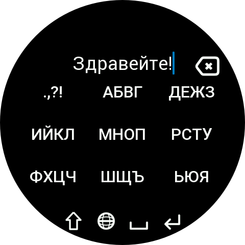

# T9 BG Keyboard

A Bulgarian and English keyboard for Zepp OS smartwatches, combining classic **Multi-tap input** with **T9 word prediction**.

The keyboard supports Bulgarian and English. In T9 mode, the sequence of key presses is used to find matching words in the user's dictionary. The keyboard automatically learns words as they are typed and gradually adapts to the user's vocabulary. Multi-tap input allows individual characters to be selected by repeatedly pressing the corresponding numeric key.

## Features

- 🇧🇬 Bulgarian layout with T9 and Multi-tap support
- 🇬🇧 English layout with T9 and Multi-tap support
- Self-learning user dictionaries, stored separately for Bulgarian and English
- Prediction bar displaying up to five suggestions
- Classic 9-key text input
- Shift for a single uppercase character
- Caps Lock, activated by holding Shift
- Numbers 0–9
- Punctuation and additional symbols
- Quick switching between Bulgarian and English layouts
- Access to other installed Zepp OS input methods
- Adjustable Multi-tap typing speed
- Support for round and square displays
- Shift enabled by default on startup

## T9 and Multi-tap: What's the Difference?

### T9 — Word Prediction

In T9 mode, press the corresponding numeric key once for each letter. The keyboard converts the key presses into a digit sequence and searches for matching words in the user dictionary. Matching suggestions appear in the prediction bar, allowing the user to select a word without entering every letter individually.

T9 BG Keyboard does not include preloaded Bulgarian or English word lists. Instead, each dictionary is built from the words the user types.

### Multi-tap — Repeated Key Presses

In Multi-tap mode, each numeric key represents a group of characters. Press the same key repeatedly to cycle through its characters.

For example, in English:

`A → B → C`

In Bulgarian:

`А → Б → В → Г`

Multi-tap allows users to enter specific characters by cycling through the characters assigned to each key.

## Self-Learning T9 Dictionary

The keyboard starts without preloaded word lists. Separate Bulgarian and English user dictionaries are built automatically during use.

The learning system:

- Saves valid words entered by the user.
- Learns words selected from the prediction bar.
- Tracks word usage separately for each language.
- Records usage frequency and the time each word was last used.
- Stores the dictionaries locally on the device.

Each language dictionary can contain up to 500 words. When the limit is exceeded, periodic cleanup removes the least-used words, using the last-used time to break ties. Cleanup runs no more frequently than once every three days.

New words are saved immediately and become available to the T9 engine after the keyboard is launched again.

This approach allows the dictionary to adapt to the user's vocabulary without requiring preinstalled or manually updated word lists.

## Keyboard Layout

### Bulgarian

| Key | Characters |
|-----|------------|
| 1 | . , ? ! |
| 2 | А Б В Г |
| 3 | Д Е Ж З |
| 4 | И Й К Л |
| 5 | М Н О П |
| 6 | Р С Т У |
| 7 | Ф Х Ц Ч |
| 8 | Ш Щ Ъ |
| 9 | Ь Ю Я |
| 0 | Space; hold to enter 0 |

### English

| Key | Characters |
|-----|------------|
| 1 | . , ? ! |
| 2 | A B C |
| 3 | D E F |
| 4 | G H I |
| 5 | J K L |
| 6 | M N O |
| 7 | P Q R S |
| 8 | T U V |
| 9 | W X Y Z |
| 0 | Space; hold to enter 0 |

In Multi-tap mode, repeatedly tap a key to cycle through its characters.

## Shift and Caps Lock

**Tap Shift**

Enables Shift for the next character.

On the punctuation key, Shift provides additional symbols:

`@ € - _`

After the next character is entered, one-shot Shift is disabled automatically. Caps Lock remains active until it is turned off.

**Hold Shift**

Enables or disables Caps Lock. In Caps Lock mode, letters are entered in uppercase.

## Numbers

Hold one of the character keys to enter its corresponding number:

`1 2 3 4 5 6 7 8 9`

Hold the **Space** key to enter:

`0`

## Language Switching and Input Methods

**Tap the Globe button**

Switches between the built-in Bulgarian and English layouts:

`BG ↔ EN`

**Hold the Globe button**

Opens the Zepp OS input method selector, allowing you to switch to another installed keyboard.

## Adjusting Multi-tap Speed

Hold the **Cancel** or **Enter** button to change the Multi-tap typing speed.

| Speed | Interval |
|---|---:|
| Very fast | 200 ms |
| Fast | 400 ms |
| Normal | 600 ms |
| Slow | 800 ms |
| Very slow | 1000 ms |

The selected speed is saved locally and used for subsequent text input.

## Delete

Tap Delete to remove the previous character.

A character that is still being selected with Multi-tap can also be deleted before it is committed.

**Hold Delete** to clear the input.

## Supported Devices

T9 BG Keyboard is designed for Zepp OS devices that support third-party input methods.

The interface includes layouts for:

- Round displays
- Square displays

Development and testing are primarily focused on 480 × 480 round devices, 390 × 450 square devices, and Bip Max. The keyboard has been tested on a real Amazfit Balance 2 and in emulators for other models.

## Requirements

- Zepp OS with third-party keyboard and `data-widget` support
- API Level 4.0 or newer

## Installation

The keyboard is implemented as a Zepp OS `data-widget`.

After installation, enable **T9 BG Keyboard** from the keyboard or input-method settings on your watch.

## Development

The project is built using the Zepp OS SDK.

The keyboard is registered as a `data-widget` and uses the Zepp OS keyboard APIs for text input, composition, function keys, and input-method switching. T9 uses separate Bulgarian and English user dictionaries, which are learned automatically and stored in the device's local storage.

## License

See the repository license for details.

## Screenshots

